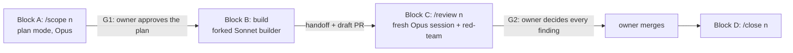

# 01. The workflow

Every issue goes through four blocks and two owner gates. A block ends where its skill says, and the next one starts from a file, not from the conversation. That is what keeps each session short.

## The blocks

| Block | Started by | Runs on | Ends with |
|---|---|---|---|
| **A: Scope** | `/scope <n>` (or `/scope <n> small`) | The main session, in plan mode, on Opus (`opusplan`) | One plan in `.harness/work/<n>/plan.md`, approved by the owner: **gate G1** |
| **B: Build** | The `build` skill, which the plan's step 0 invokes | A forked `builder` subagent on Sonnet | A draft PR, CI passing on its head, and `.harness/work/<n>/handoff.md` |
| **C: Review** | `/review <n>` | A fresh Opus session; the `red-team` reads the diff | One report to the owner with numbered decisions: **gate G2**. Then the fixes, one narrow re-review, and "ready to merge" |
| **D: Close** | `/close <n>` (or `/close <n> epic`), after the owner merges | The main session | The branch and working files removed, memory notes condensed, and on an epic, a knowledge audit |

What each skill does step by step is in [02. Skills and agents](02-skills-and-agents.md).

## The gates

- **G1 (plan).** The owner reads the full plan and may edit it. Nothing is implemented before it. The plan has a fixed shape that `handoff-check.cjs --plan` validates: scope, facts checked, acceptance criteria, sub-phases with a check each, rejected approaches, invariants, docs likely to go stale, and what's out of scope.
- **G2 (review).** The owner gets one message: a table of findings and PR comments, each with a recommendation, the acceptance criteria, the docs, and a numbered list of decisions, so one reply ("1, 2 fix; 3 decline") answers them all. A blocking finding (security, data integrity, correctness) can't be deferred to a follow-up issue unless the owner accepts it explicitly.
- **The owner merges.** The harness never merges, never pushes to the default branch and never force-pushes (see [03. Hooks and scripts](03-hooks-and-scripts.md#permissions)).

## Tiers

| | Standard (the default) | Small (`/scope <n> small`) |
|---|---|---|
| **Fits** | Anything | One sub-phase; no schema, data-migration, auth, security or dependency change; no change to a public interface |
| **Sessions** | A, then `/clear` and "continue <n>" for B; C in a fresh `claude --model opus` session | One session: A, the forked build, then `review` in the same session |
| **Gates** | G1 and G2 | The same G1 and G2 |

- The owner picks the tier. `/scope` recommends Standard when an issue doesn't fit Small, and checks again after G1's answers when they add a sub-phase, a fix or a UI check, or when there were more than 3 decisions.
- The plan's first line records the tier (`# Plan: #<n> <title> · Tier: Standard | Small`). When the build returns, that line decides what happens next, not the fork's reply.
- `handoff-check.cjs --plan` refuses a Small plan with more than one sub-phase.

## Working state

Everything about an issue in progress lives in `.harness/work/<n>/`, which is gitignored:

| File | Written by | Read by |
|---|---|---|
| `plan.md` | `/scope` | `build`, the session-state hook, `review` |
| `plan-comment.txt` | `build` (the URL of the plan posted to the issue) | `build`, so it posts only once |
| `stale-docs.md` | `stale-docs.cjs --record`, plus `ack:` lines | the docs gate |
| `handoff.md` | `build` | `review` (also posted to the issue) |
| `gate.json` | the check gate (its failure count) | the check gate |
| `BLOCKED` | the check gate | every block, the session-state hook and `handoff-check.cjs` |
| `ui/` | `build`, on a UI check | the owner, at G2 |

`.harness/work/hooks.log` keeps one JSON line per hook or script event, and `.harness/work/.lastpass` the fingerprint of the last passing fast check.

The approved plan and the handoff are also posted as comments on the issue. Those comments are the lasting record; `/close` removes the folder.

## When it stops

- **`BLOCKED`.** After 3 failed fast checks in a row, the check gate writes `.harness/work/<n>/BLOCKED`. Every block stops when it sees it, and the session-state hook names it in a fresh session. The owner decides: amend the plan, resume in a fresh Opus session, or stop. A passing fast check later removes it.
- **`QUESTION:`.** The forked builder can't ask the owner. When the plan doesn't cover something (a behaviour change, a new dependency, a scope change), it commits nothing past the gap and ends its reply with `QUESTION: <the question>`. The main session relays it, and `build` resumes from the next uncommitted sub-phase.
- **`MAIN SESSION:`.** The builder ends its reply with a `MAIN SESSION:` line for anything only the main session can do: turning off the app's PR monitoring (Auto-fix), which the fork can't reach, and on Small, running `review`. The UI check is not one of these: the builder runs it itself.

## Design record

- [OPTIMIZATION_PLAN.md](../Evidence/OPTIMIZATION_PLAN.md) §4 (blocks, gates and tiers), §5.4 and §5.5 (the plan and handoff templates).
- [research/09](../Evidence/research/09-small-tier.md) (the Small tier) and [research/11](../Evidence/research/11-meta-analysis.md) §12 (D25: the plan's tier decides, and the UI check stays in the builder).
