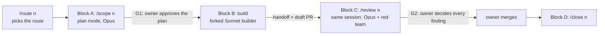

# 01. The workflow

Every issue starts with `/route <n>`, then goes through four blocks and two owner gates. A block ends where its skill says, and the next one starts from a file, not from the conversation. That is what keeps each session short.

## The blocks

| Block | Started by | Runs on | Ends with |
|---|---|---|---|
| **Route** | The owner types `/route <n> [small]` | The main session | One route: scope now, draft first, audit first, diagnose first, the light lane, the Epic close, or lay out the Epic. It starts the first step itself, and writes `route.md` when there is more than one |
| **A: Scope** | `/route`, or `/scope <n>` (`small`, `light`) | The main session, in plan mode, on Opus (`opusplan`) | One plan in `.harness/work/<n>/plan.md`, approved by the owner: **gate G1** |
| **B: Build** | The `build` skill, which the plan's step 0 invokes | A forked `builder` subagent on Sonnet | A draft PR, CI passing on its head, and `.harness/work/<n>/handoff.md` |
| **C: Review** | `/review <n>` | The session that started the build, on Opus; the `red-team` reads the diff | One report to the owner with numbered decisions: **gate G2**. Then the fixes, one narrow re-review, and "ready to merge" |
| **D: Close** | `/close <n>` (or `/close <n> epic`), after the owner merges | A fresh session | The branch and working files removed, memory notes condensed, and on an epic, a knowledge audit |

What each skill does step by step is in [02. Skills and agents](02-skills-and-agents.md).

## The gates

- **G1 (plan).** The owner reads the full plan and may edit it. Nothing is implemented before it. The plan has a fixed shape that `handoff-check.cjs --plan` validates: scope, facts checked, acceptance criteria, sub-phases with a check each, rejected approaches, invariants, docs likely to go stale, and what's out of scope.
- **G2 (review).** The owner gets one message: a table of findings and PR comments, each with a recommendation, the acceptance criteria, the docs, and a numbered list of decisions, so one reply ("1, 2 fix; 3 decline") answers them all. A blocking finding (security, data integrity, correctness) can't be deferred to a follow-up issue unless the owner accepts it explicitly.
- **The owner merges.** The harness never merges, never pushes to the default branch and never force-pushes (see [03. Hooks and scripts](03-hooks-and-scripts.md#permissions)).

## Tiers

| | Standard (the default) | Small (`/scope <n> small`) |
|---|---|---|
| **Fits** | Anything | One sub-phase; no schema, data-migration, auth or security change; no dependency added, removed or upgraded (moving one between groups is fine, and so is removing one the code no longer uses when the dependency graph shows nothing else moving); no change to a public interface |
| **Sessions** | A, then `/clear` and "continue <n>" for B; C in the same session as B (it stays near its start, as the build runs forked); D after `/clear` | One session: A, the forked build, then `review` in the same session |
| **Gates** | G1 and G2 | The same G1 and G2 |

- The owner picks the tier. `/scope` recommends Standard when an issue doesn't fit Small, and checks again after G1's answers when they add a sub-phase, a fix or a UI check, or when there were more than 3 decisions. Raising the tier is a question; confirming or lowering it goes in the plan for the G1 accept.
- The plan's first line records the tier (`# Plan: #<n> <title> · Tier: Standard | Small`). When the build returns, that line decides what happens next, not the fork's reply.
- `handoff-check.cjs --plan` refuses a Small plan with more than one sub-phase. A `G2 fixes` sub-phase that `review` appends doesn't count.
- **Content, art or design drafted with the owner,** an audit, or a diagnosis comes before `/scope`: `/route` runs it, and it ends in an approved file that `/scope` plans from.
- **The light lane** (`/scope <n> light`, or offered at G1 when the plan turns out that small): one docs, config or decline sub-phase with no change in behaviour, its plan marked `Lane: light`. After G1 the same session branches, makes the change, opens the draft PR with Auto-fix off, waits for CI and marks it ready, with no fork and no handoff; the red-team runs only if the owner asks.

## G2 fixes

After G2, `review` makes doc and rule fixes, and code fixes of a few lines in one or two files, itself; it then waits for CI and rewrites the handoff's head line. Multi-file code fixes, and new scope the owner approves, go back to the forked builder: `review` appends a `G2 fixes` sub-phase to the plan and runs `build <n> amend`, which builds it on Sonnet, pushes, waits for CI and writes the handoff for the new head. Then `review` runs its one narrow re-review, and on a UI run a narrow `ui-check`. On D25 big fixes cost the most when the Opus review session made them itself; on D26 small ones cost more through the builder than in the session (research/16 §3.3).

## An Epic's close

An Epic's close is one command, `/close <n> epic`, run twice. The first run (no branch yet, so `close.cjs` exits 4) runs the knowledge audit, asks the owner in one dialog which findings to fix, and fixes them in place as a Small docs pass. Findings that need code become issues. After that PR merges, the second run cleans up, `audit.md` with it. A first run that finds an `audit.md` uses it rather than auditing again, and one where the owner picks nothing finishes the close there. `/route` starts it on an Epic issue whose phases are closed, and `/layout-epic` on one with no phases yet.

## Working state

Everything about an issue in progress lives in `.harness/work/<n>/`, which is gitignored:

| File | Written by | Read by |
|---|---|---|
| `plan.md` | `/scope` | `build`, the session-state hook, `review` |
| `plan-comment.txt` | `build` (the URL of the plan posted to the issue) | `build`, so it posts only once |
| `route.md` | `/route`, when the route has more than one step | each later step |
| `draft/`, `diagnosis.md` | `/route` | `/scope` |
| `handoff.md` | `build` (`review` renames it to `handoff-<k>.md` before a G2 fixes round) | `review` (also posted to the issue) |
| `gate.json` | the check gate (its failure count) | the check gate |
| `BLOCKED` | the check gate | every block, the session-state hook and `handoff-check.cjs` |
| `ui/` | the `ui-check` agent | the owner, at G2 |
| `audit.md` | `close` on an Epic, or `/route` for an audit-first issue | `close`, so the audit runs once; `/scope` |

`.harness/work/hooks.log` keeps one JSON line per hook or script event, and `.harness/work/.lastpass` the fingerprint of the last passing fast check.

The approved plan and the handoff are also posted as comments on the issue. Those comments are the lasting record; `/close` removes the folder.

## When it stops

- **`BLOCKED`.** After 3 failed fast checks in a row, the check gate writes `.harness/work/<n>/BLOCKED`. Every block stops when it sees it, and the session-state hook names it in a fresh session. The owner decides: amend the plan, resume in a fresh Opus session, or stop. A passing fast check later removes it.
- **`QUESTION:`.** The forked builder can't ask the owner. When the plan doesn't cover something (a behaviour change, a new dependency, a scope change), it commits nothing past the gap and ends its reply with `QUESTION: <the question>`. The main session relays it, and `build` resumes from the next uncommitted sub-phase.
- **`MAIN SESSION:`.** The builder ends its reply with a `MAIN SESSION:` line for anything only the main session can do: turning off the app's PR monitoring (Auto-fix), which the fork can't reach, on Small, running `review`; and after a G2 fixes round, the narrow re-review. The UI check isn't the builder's: `review` runs it on the `ui-check` agent.

## Design record

- [OPTIMIZATION_PLAN.md](../Evidence/OPTIMIZATION_PLAN.md) §4 (blocks, gates and tiers), §5.4 and §5.5 (the plan and handoff templates).
- [research/09](../Evidence/research/09-small-tier.md) (the Small tier), [research/11](../Evidence/research/11-meta-analysis.md) §12 (D25: the plan's tier decides) and [research/13](../Evidence/research/13-d25-meta-analysis.md) §9–10 (D26: G2 fixes forked, the UI check on its own agent, the Epic close).
- [research/16–18](../Evidence/research/16-d26-meta-analysis.md) (D27: `/route`, review in the build's session, the UI check's cost, the one-command Epic close, and the removals).
