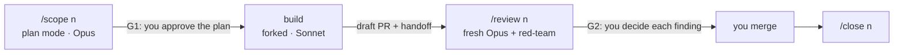

# ProdHarnessConfig

A production harness for [Claude Code](https://code.claude.com/docs): the workflow, skills, subagents, hooks and scripts I use to take a GitHub issue from plan to merge, with a person deciding at two gates and the agent doing the rest.

It was built from measured session data, and it's measured on every issue it runs. A typical issue now costs about 40% less than one long session did, with less than half the context and fewer messages from me.

**Who this is for:** developers who already use Claude Code on real projects, and want a repeatable way to run it on issues that keeps cost and context down without giving up review. You'll need GitHub, CI on pull requests, and the habit of reading a plan before it's built.

**What this is not:**
- **A framework or a product.** It is one owner's working setup, documented so you can adapt it.
- **Hands-off.** The design assumes someone approves every plan, decides every review finding and merges by hand. Those gates are part of the architecture.
- **Settled.** The current version (D25) is still being validated, and several of its rules are trials under measurement.

## How an issue goes



1. **`/scope <n>`:** reads the issue, surveys the code, asks its open questions with a recommendation each, and writes one plan. You approve it (**G1**).
2. **`build`:** a forked Sonnet subagent implements the plan one sub-phase at a time, with a check per sub-phase. It opens a draft PR, waits for CI and writes a handoff.
3. **`/review <n>`:** a fresh Opus session briefs a read-only red-team on the handed-off commit, triages its findings with the PR's comments, and brings you one report with numbered decisions (**G2**). It fixes what you approve and re-reviews once.
4. **You merge;** then `/close <n>` cleans up.

Each step starts a new context from a file (the plan, the handoff), so no session carries the whole issue. A **Small** tier runs the same gates in one session for single-step issues. Hooks enforce the rest: no stop while checks fail, and no commit that leaves a doc stale. Permission rules, backed by a GitHub ruleset, rule out a merge or a force push.

The details are in [Docs/01. The workflow](Docs/01-workflow.md).

## Results

From [Evidence/research/11](Evidence/research/11-meta-analysis.md): 30 issue runs, each re-priced from its transcripts by one script ([`runs.js`](Evidence/research/scripts/runs.js)). 15 ran before the harness: 10 code issues on BabyBuddyHelper (.NET MAUI) and 5 docs issues on HarnessEngineering101. 15 ran with it, on BabyBuddyHelper and InvoiceMe (MERN).

| | Before the harness (10 code issues, BabyBuddyHelper) | Harness, Standard tier (5 issues: 4 InvoiceMe, 1 BabyBuddyHelper) |
|---|---|---|
| Median cost per issue | $9.99 | **$6.03** (every run ≤ $6.43) |
| Main-session peak context | 291k tokens | **121–129k** |
| Owner messages per issue | 11 | **7** |
| Context before the first prompt | — | 73–80k |

- **The biggest single change** was running the build forked on Sonnet. Block B fell from $8.04–9.38 on Opus in the main session to $1.25–1.99.
- **Quality held.** No blocking finding was left at merge. Review found 0–3 fix-worthy problems per issue, and most of them were doc lines a change had made untrue.
- **Caveats:**
  - The costs are list-price equivalents; I'm on a subscription.
  - The samples are small, with one owner, so the medians show direction, not effect size.
  - The two columns come mostly from different repositories: the code baseline is BabyBuddyHelper only, and 4 of the 5 Standard runs are InvoiceMe. The issues differ in size too.
  - The Small tier is cheaper only when nothing heavy follows the plan (median $2.92 on docs issues, $4.88 on code issues).
  - D25, the version installed now, is under validation.

## Get started

**[Onboard/GET_STARTED.md](Onboard/GET_STARTED.md)** covers:
- prerequisites;
- describing your project in a `harness.json`;
- installing with `scripts/install.cjs`, a dry run first;
- writing your `CLAUDE.md`;
- a first issue, end to end.

Not on Claude Code? **[Platform_Neutral/](Platform_Neutral/README.md)** separates the ideas that carry over to any agent (the gates, the contracts, the fresh-context reviewer, the docs gate, pricing each run) from the Claude Code features used to build them. It also has a setup prompt for any agent.

## Design principles

- **The owner decides; the agent recommends.** Every open decision comes as options with one recommended, and nothing outside the plan gets built without asking.
- **End the session at the gate.** Cost tracks calls × context, so every block starts fresh from a file instead of carrying the conversation.
- **The right model for each block.** Opus plans and reviews; Sonnet builds and surveys.
- **Review one commit, independently.** The red-team never sees the builder's reasoning. A push after the handoff makes the review refuse.
- **Enforce with code, not with prompts.** Exit codes, gates and server-side branch rules, wherever a rule can be checked.
- **Measure before claiming.** Every change is judged on priced runs, and the data and the script are in the repo.

## Repo map

```
README.md                  this page
Docs/                      reference: workflow, skills and agents, hooks and scripts, harness.json, installer
Onboard/                   Get Started (the installer moves here in #4)
Platform_Neutral/          the ideas without Claude Code, and a setup prompt for any agent
harness/.claude/           what gets installed: CLAUDE.md template, settings, skills, agents, hooks, scripts, lib
projects/<Project>/        each project's harness.json, install.json and vendored skills
scripts/install.cjs        installs and upgrades the harness in a project
test/                      node --test suites for the hooks, scripts, installer and configs
Evidence/
  OPTIMIZATION_PLAN.md     the design record: decisions D1–D25, with § numbers the code cites
  ADOPTION_PLAN.md         how the harness was adopted in the two projects
  research/                the measurements, pilot by pilot, and the pricing scripts
  Independent_Assessments/ four other AI models' assessments of the first plan, and the reviews of them
  harness_optimization_blueprint.md  the starting proposal
```

Run the tests with `npm test` (Node 22 or later).

## Related

- [HarnessEngineering101](https://github.com/MatheusCastro99/HarnessEngineering101): the study repository this harness came out of.

## License

[MIT](LICENSE). The vendored `frontend-design` skill under `projects/InvoiceMe/vendor/` keeps its own license (Apache-2.0).
